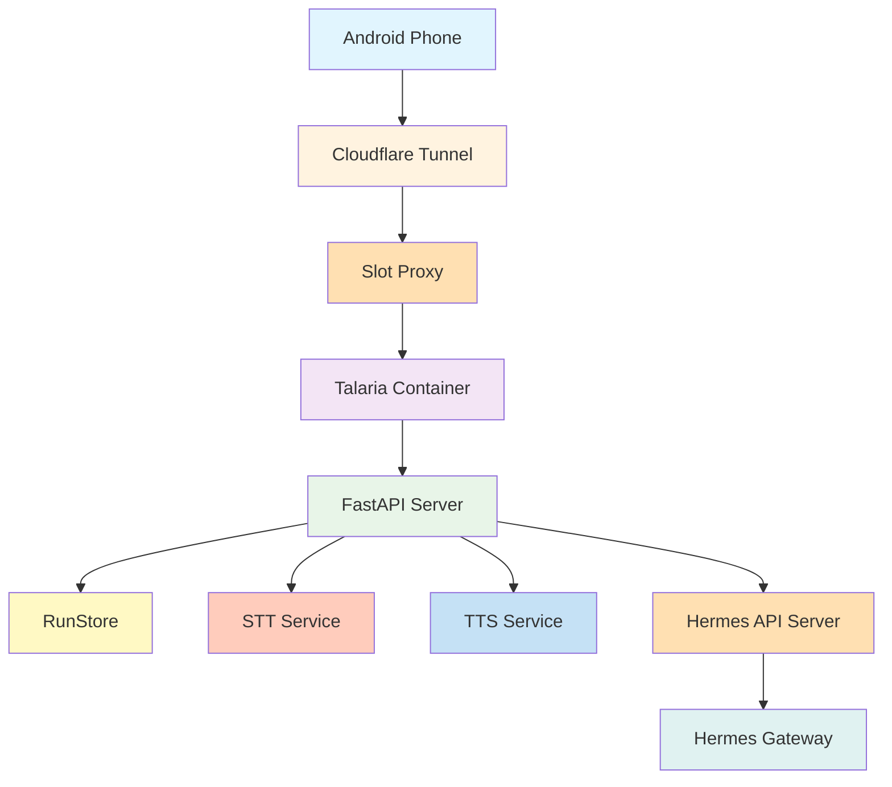

# Talaria Architecture Documentation

## Overview
Talaria is a real-time voice PTT (Push-to-Talk) gateway for Hermes Agent, providing a WebSocket-based interface for Android clients to interact with AI agents through voice.

## System Architecture

### Core Components



### Data Flow

#### External -> Internal
1. **Audio Capture** (Android)
   - 16kHz PCM audio recorded during PTT
   - Opus encoded for transmission

2. **WebSocket Tunnel**
   - wss://talaria.ffilt.us/v1/ptt
   - Cloudflare Access token validation
   - Slot-based routing

3. **Internal Processing**
   ```
   Talaria Container → Hermes API Server → Hermes Gateway
   (Port 8321)      (Port 8642)                   (Port 9119)
   ```

#### Internal Processing Pipeline
```
1. Audio Reception
   ├── Raw PCM to Opus decode
   └── WebSocket frame extraction

2. Speech-to-Text
   ├── Audio buffer accumulation
   ├── Faster-Whisper inference
   └── Transcript generation

3. Agent Communication
   ├── Hermes API REST client
   ├── Run management (start/events/stop)
   └── Response streaming

4. Text-to-Speech
   ├── Edge-TTS synthesis
   ├── Audio chunk streaming
   └── Opus encoding

5. Audio Transmission
   ├── Opus packets to client
   └── WebSocket binary frames
```

## Component Details

### 1. Talaria Server (server.py)

#### Core Services
- **WebSocket Protocol Handler**: Manages PTT protocol and audio stream
- **State Machine**: PTTState enum (IDLE, RECORDING, TRANSCRIBING, HERMES_RUNNING, TTS_STREAMING, INTERRUPTED)
- **Connection Replay**: RunStore for handling disconnections and audio resume
- **Model Management**: Lazy-loaded STT/TTS models in background

#### Key Classes
```python
class RunResult:  # Audio transcript storage
    run_id: str
    session_id: str
    transcript: str
    reply_text: str
    audio_chunks: list[bytes]
    complete: bool
    # ... other fields

class RunStore:  # Connection replay storage
    _runs: dict[tuple[str, str], RunResult]
    _consumed: set[str]
    # ... methods for save/retrieve
```

### 2. Hermes API Server (hermes_api_server.py)

#### API Endpoints
- `POST /v1/runs` - Start a Hermes agent run
- `GET /v1/runs/{run_id}/events` - Stream agent response events
- `POST /v1/runs/{run_id}/stop` - Interrupt running agent

#### Technical Details
- **Protocol**: WebSocket + SSE (Server-Sent Events)
- **Authentication**: Bearer token in Authorization header
- **Format**: OpenAI Responses API compatible (`{"input": "..."}`)

### 3. Android Client (Android App)

#### Audio Pipeline
```kotlin
// Audio recording
val audioSource = MediaRecorder.AudioSource.MIC
val audioFormat = MediaRecorder.OutputFormat.OGG
val audioEncoder = MediaRecorder.AudioEncoder.OPUS

// WebSocket connection
val socket = OkHttpClient().newWebSocketRequest()
    .url("wss://talaria.ffilt.us/v1/ptt")
    .build()
```

#### Protocol Commands
```json
// Client → Server
{
  "type": "ptt_start",
  "client_message_id": "optional-id"
}

{
  "type": "ptt_end"
}

{
  "type": "interrupt"
}

{
  "type": "reconnect",
  "session_id": "...",
  "thread_id": "...",
  "last_seq": 123
}
```

## Design Patterns

### 1. State Machine Pattern
Used for PTT session management.

```python
class PTTStateMachine:
    def __init__(self):
        self.current_state = PTTState.IDLE
        self.transitions = {
            PTTState.IDLE: [PTTState.RECORDING, PTTState.IDLE],
            PTTState.RECORDING: [PTTState.TRANSCRIBING, PTTState.IDLE],
            # ... etc
        }
    
    def can_transition(self, new_state):
        return new_state in self.transitions.get(self.current_state, [])
```

### 2. Singleton Pattern
```python
# Global instances
run_store = RunStore()
_stt_pipeline = None
_tts_available = False
_background_init_task = None
```

### 3. Lazy Loading Pattern
```python
async def init_stt():
    global _stt_pipeline
    if _stt_pipeline is None:
        async with _stt_init_lock:
            if _stt_pipeline is None:
                _stt_pipeline = await self._load_model()
```

## Technology Stack

### Runtime Dependencies
- **Python**: 3.12
- **Web Framework**: FastAPI
- **Speech-to-Text**: faster-whisper
- **Text-to-Speech**: edge-tts
- **Audio Processing**: ffmpeg
- **WebSocket**: FastAPI WebSocket support

### Container Configuration
```yaml
# Dockerfile (multi-stage build)
FROM docker.io/python:3.12-slim AS builder
RUN pip install --no-cache-dir \
    fastapi uvicorn numpy httpx \
    faster-whisper edge-tts

FROM docker.io/python:3.12-slim
COPY --from=builder /usr/local/lib/python3.12/site-packages ...
RUN apt-get update && apt-get install -y ffmpeg
```

## Deployment Architecture

### Service Discovery via Agent-Stack
```json
{
  "name": "talaria",
  "container": {
    "port": 8321,
    "auto_port": true,
    "podman_args": "--memory 2g",
    "env": {
      "HOST": "0.0.0.0",
      "PORT": "8321",
      "TALARIA_DOMAIN": "talaria.ffilt.us",
      "HERMES_API_URL": "http://hermes--api:8642",
      "HERMES_API_KEY": "{SECRETS.HERMES_API_KEY}",
      "STT_MODEL": "base",
      "LOG_LEVEL": "info",
      "HF_HOME": "/app/cache"
    },
    "volumes": ["talaria-cache:/app/cache"],
    "healthCheck": {
      "path": "/health",
      "timeout": 15000
    }
  },
  "expose": {
    "enabled": true,
    "hostname": "talaria.ffilt.us",
    "tunnel": "ca308a1b-557a-4a18-9350-6eec27465bdf"
  },
  "strategy": { "type": "blue-green", "queue": true }
}
```

### Network Diagram
```mermaid
graph LR
    Browser[User Browser] --> CloudFlare[Cloudflare Access]
    CloudFlare --> Tunnel[Cloudflare Tunnel]
    Tunnel --> SlotProxy[Slot Proxy]
    SlotProxy --> Container[Talaria Container]\n    Port 8321
    
    subgraph "Container Internal"
        Direction LR
        HermesAPI[Hermes API Server]\n        Port 8642
        TalariaServer[Talaria Server]\n        Port 8321
    end
    
    Container -.-> HermesAPI
    HermesAPI --> HermesGateway[Hermes Gateway]\n    Port 9119
    HermesGateway -.-> ModelServer
```

## Operational Flow

### 1. Client Connection
```
1. Android app establishes WebSocket connection
2. Client sends reconnect handshake (first message)
3. Server checks for undelivered runs
4. If run exists → replay audio/transcript
5. Connection established for PTT
```

### 2. PTT Session
```
1. User presses PTT → audio recording starts
2. Audio captured as PCM 16kHz mono
3. Audio buffer accumulates until PTT released
4. `ptt_end` command triggers processing
5. Audio sent to faster-whisper for STT
6. Hermes agent invoked with transcript
7. Agent response streamed via SSE
8. Edge-TTS converts text to audio
9. Opus packets streamed back to client
```

### 3. Interruption & Reconnection
```
# Barge-in (Interrupt)
- Client sends "interrupt" command
- Current TTS synthesis stopped
- Hermes run stopped via API
- Back to IDLE state

# Reconnection after disconnect
- Client sends reconnect handshake
- Server checks RunStore for session_id
- Undelivered run replayed
- Audio playback resumes where left off
```

## Security Considerations

### 1. Authentication
- **Cloudflare Access**: JWT-based token validation
- **Hermes API**: Bearer token authentication
- **Vault Integration**: Environment variable secrets resolution

### 2. Network Security
- **TLS/SSL**: HTTPS for all external connections
- **Cloudflare Tunnels**: Internal network access control
- **Slot-based Routing**: Multi-tenant isolation

### 3. Data Protection
- **Audio Buffer Limits**: Prevents memory exhaustion
- **Connection Cleanup**: Automatic timeout and garbage collection
- **Replay Security**: Session-based replay control

## Monitoring & Observability

### 1. Health Endpoints
```http
GET /health
{
  "status": "ok",
  "stt_loaded": true,
  "tts_available": true,
  "hermes_api": "http://hermes--api:8642",
  "pending_replays": 3
}
```

### 2. Metrics
- **Connection Count**: Active WebSocket connections
- **Audio Processing Time**: STT/TTS pipeline latency
- **Replay Usage**: Connection resume frequency
- **Error Rates**: Failed STT/TTS operations
- **Memory Usage**: Audio buffer utilization

### 3. Logging
- **Structured Logging**: JSON format with correlation IDs
- **Performance Tracking**: Request/response timing
- **Error Tracking**: Detailed error context and stack traces

## Troubleshooting Guide

### Common Issues

#### 1. Audio Quality Problems
```bash
# Check audio levels
ffprobe input.ogg

# Verify Opus encoding
ffmpeg -i input.pcm -c:a opus output.ogg
```

#### 2. Connection Drops
```bash
# Check server logs
podman logs talaria--slot-a

# Verify network connectivity
curl -v http://localhost:8321/health
```

#### 3. STT/TTS Model Loading
```bash
# Check model cache
ls -la /app/cache/

# Verify model availability
python3 -c "from faster_whisper import WhisperModel; print('Model loaded')"
```

### Debugging Commands
```bash
# Start Talaria container
cd /srv/agent-stack && ./controller build talaria
./controller deploy talaria

# Check health
curl http://talaria.ffilt.us/health

# Test WebSocket connection
wscat -c ws://talaria.ffilt.us:8321/v1/ptt
```

## Future Enhancements

### 1. Scalability
- Implement Redis-backed run store for multi-node scaling
- Add connection pooling for high-frequency users
- Implement gRPC for lower-latency audio streaming

### 2. Features
- Multi-user session support
- Voice activity detection (VAD)
- Audio quality enhancement
- Real-time analytics dashboard

### 3. Performance
- CPU/GPU acceleration for STT/TTS
- Audio compression optimization
- Connectionless UDP fallback for mobile

## References

- [Hermes Agent Architecture](https://github.com/hermes-ai/hermes)
- [FastAPI Documentation](https://fastapi.tiangolo.com/)
- [faster-whisper GitHub](https://github.com/guiltbyversa/faster-whisper)
- [Edge TTS Documentation](https://github.com/liujeton/edge-tts)
